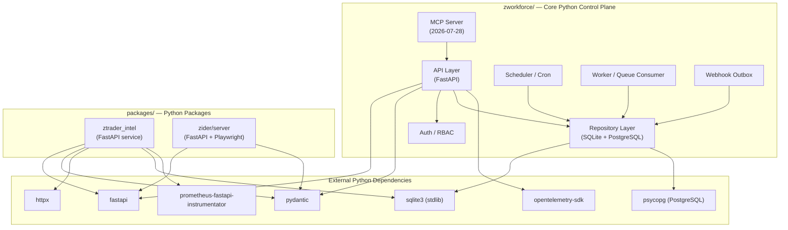
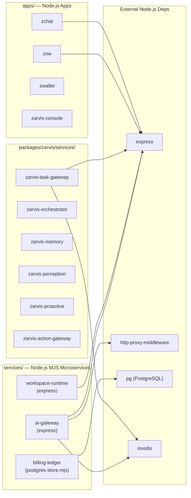
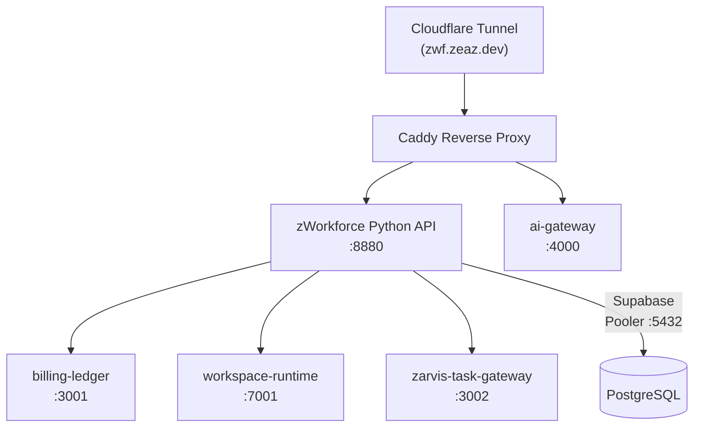

# ZWorkforce Dependency Graph

**Generated:** 2026-11-05 UTC+7  
**Analysis Scope:** Python (687 files), Node.js/TypeScript (762 files), Infrastructure (Terraform, Kubernetes, Compose)

> [!NOTE] Machine-readable details are in [`DEPENDENCY-REPORT.json`](./DEPENDENCY-REPORT.json).

## Python Control Plane Dependencies

## Node.js / MJS Service Dependencies

## Cross-Service Communication

## Top Third-Party Python Dependencies (by usage frequency)

| Package | References | Purpose |
|---|---|---|
| `fastapi` | 41 | HTTP API framework (control plane + service APIs) |
| `pytest` | 95 | Test framework |
| `httpx` | 39 | Async HTTP client (inter-service calls) |
| `pydantic` | — | Data validation (fastapi models) |
| `psycopg` | — | PostgreSQL async driver |
| `sqlite3` | — | stdlib SQLite (default store) |
| `prometheus_fastapi_instrumentator` | — | Prometheus metrics exposure |
| `opentelemetry` | — | Distributed tracing (OTLP/HTTP) |
| `hashlib` | 68 | SHA-256 artifact verification |
| `asyncio` | 41 | Async runtime |

## Circular Dependency Check

No circular imports detected between top-level packages in the Python control plane (`zworkforce/` is self-contained; `ztrader_intel` and `zider` are independent FastAPI services with no mutual imports).

> [!TIP] The `wire` module (74 references) is an internal `services/zc/src/wire/` package used by the ZCoder service. It has no cross-package circular dependencies.
