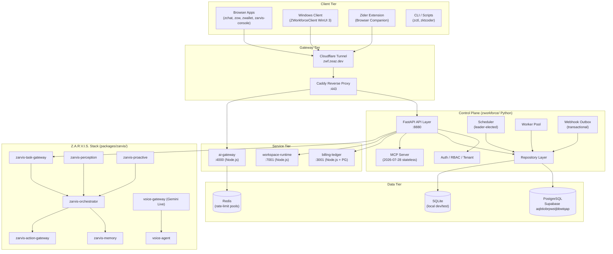
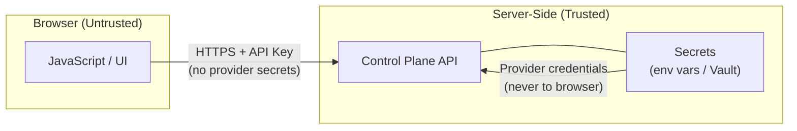

# ZWorkforce Repository Architecture

**Version:** v3.0.4 corrective candidate (provisional)  
**Generated:** 2026-11-05 UTC+7  
**Baseline SHA:** `1249243958280c5499a564180d32f6677d8791ff`

> [!IMPORTANT] v3.0.3 เป็น immutable predecessor (SHA `4ffdfa6`). v3.0.4 เป็น corrective candidate — ห้ามสร้าง tag หรือ publish จนกว่าจะผ่าน Production Evidence Stages A–I และได้รับ GO Authorization จาก release authority

## High-Level Architecture



## Directory Structure

```
/home/cvsz/zworkforce/           (3,092 tracked files)
├── zworkforce/                  # 🔵 Core Python control plane (137 files)
│   ├── api.py, app.py, main.py  # FastAPI application
│   ├── repository.py            # Durable state repository (SQLite + PostgreSQL)
│   ├── scheduler.py             # Leader-elected cron scheduler
│   ├── worker.py                # Task queue worker
│   ├── outbox.py                # Transactional webhook outbox
│   ├── auth.py                  # Authentication and RBAC
│   ├── mcp_server.py            # MCP 2026-07-28 stateless endpoint
│   └── ...
│
├── packages/                    # 1,659 files
│   ├── zarvis/                  # 🟢 CANONICAL Z.A.R.V.I.S. platform
│   │   ├── services/            # Zarvis microservices (canonical source)
│   │   │   ├── zarvis-orchestrator/   # +live_voice, +skill-catalog vs services/
│   │   │   ├── zarvis-task-gateway/   # +durable-adapters, +orchestrator-core
│   │   │   ├── voice-agent/           # +extended healthcheck
│   │   │   └── [5 identical mirrors]
│   │   ├── apps/                # Zarvis UI apps (canonical source)
│   │   └── packages/contracts/  # TypeScript inter-service contracts
│   ├── zider/                   # Browser companion BFF (FastAPI + Playwright)
│   ├── ztrader/zeaz-intelligence/ # Trading intelligence sidecar (FastAPI)
│   ├── zeto/                    # Content factory (Node.js)
│   ├── zsp-aitool/              # Next.js studio app (Prisma + PostgreSQL)
│   ├── wall-street/             # Trading signal service
│   ├── contracts/               # Shared TypeScript types
│   ├── zksato/                  # [git submodule]
│   ├── zmovie/                  # [git submodule]
│   ├── zok/                     # [git submodule]
│   └── zttshop-php/             # [git submodule]
│
├── services/                    # 489 files — Node.js microservices
│   ├── ai-gateway/              # AI provider reverse proxy + rate limiting
│   ├── billing-ledger/          # Durable billing (SQLite/PostgreSQL)
│   ├── workspace-runtime/       # Sandboxed code execution
│   ├── zarvis-*/                # ⚠️ MIRROR of packages/zarvis/services/ (some behind)
│   ├── zc/                      # ZCoder service (Python wire protocol)
│   └── zc-api/                  # ZCoder API (Node.js)
│
├── apps/                        # 165 files — Browser/Node applications
│   ├── zchat/                   # ZChat web app
│   ├── zow/                     # Operator workbench (four-eyes gate)
│   ├── zwallet/                 # ZWallet crypto frontend
│   ├── zarvis-console/          # ⚠️ MIRROR of packages/zarvis/apps/zarvis-console/
│   ├── zaicoder/                # AI coding IDE
│   ├── agent-control-panel/     # Agent dashboard (React)
│   └── frontend/                # Various frontends (canva-app, reui-dashboard)
│
├── ZWorkforceClient/            # Windows native WinUI 3 client (C#/.NET)
│
├── infrastructure/
│   ├── kubernetes/base/         # Kubernetes manifests (kustomize)
│   └── terraform/cloudflare/   # Cloudflare DNS, Access, Tunnel
│
├── deploy/
│   ├── caddy/Caddyfile          # Reverse proxy config
│   ├── cloudflare/              # Tunnel ingress YAML
│   └── docker/                  # Dockerfiles
│
├── tests/                       # Repository-level policy + integration tests
├── docs/                        # Documentation (architecture, security, reports)
├── scripts/                     # Operational scripts
├── planning/                    # Release and feature planning
├── .github/                     # GitHub Actions, rulesets, CODEOWNERS
└── .agents/                     # AI agent skill definitions
```

## Security Boundaries



**Key invariants (enforced by tests):**
1. Browser code never receives provider secrets, database credentials, or admin tokens
2. Cloudflare Tunnel never exposes PostgreSQL port directly
3. Open WebUI bound to `127.0.0.1` only (no public exposure)
4. Mutation endpoints are deny-by-default (require explicit approval grants)
5. Submodule checkouts use HTTPS only (SSH deploy keys removed from PR workflows)
6. `AnalysisStore` and `EventBus` are tenant-scoped (no cross-tenant data leakage)
7. `billing-ledger` uses database-enforced idempotency (unique constraint on `idempotency_key`)
8. `workspace-runtime` requires HMAC-signed four-eyes approval for execute/deploy

## Production Evidence Status (as of 2026-11-05)

| Stage | Status |
|---|---|
| A — Staging topology + immutable OCI digest | PENDING EXTERNAL EVIDENCE |
| B — PostgreSQL backup/restore/PITR | PENDING EXTERNAL EVIDENCE |
| C — Production OIDC/JWKS + API key lifecycle | PENDING EXTERNAL EVIDENCE |
| D — Provider routing + failover + bounded execution | PENDING EXTERNAL EVIDENCE |
| E — Scheduler/worker/outbox HA lease exclusivity | PENDING EXTERNAL EVIDENCE |
| F — External S3 artifact write/read + SHA-256 | ✅ PASS (Supabase `aqbtiobrpwstjbbwtqap`, 2026-10-29 UTC) |
| G — OTLP trace correlation + alert receipt | PENDING EXTERNAL EVIDENCE |
| H — Trusted Windows MSIX signing + live HTTPS install | PENDING EXTERNAL EVIDENCE |
| I — Final GO decision + rollback target | PENDING EXTERNAL EVIDENCE |
